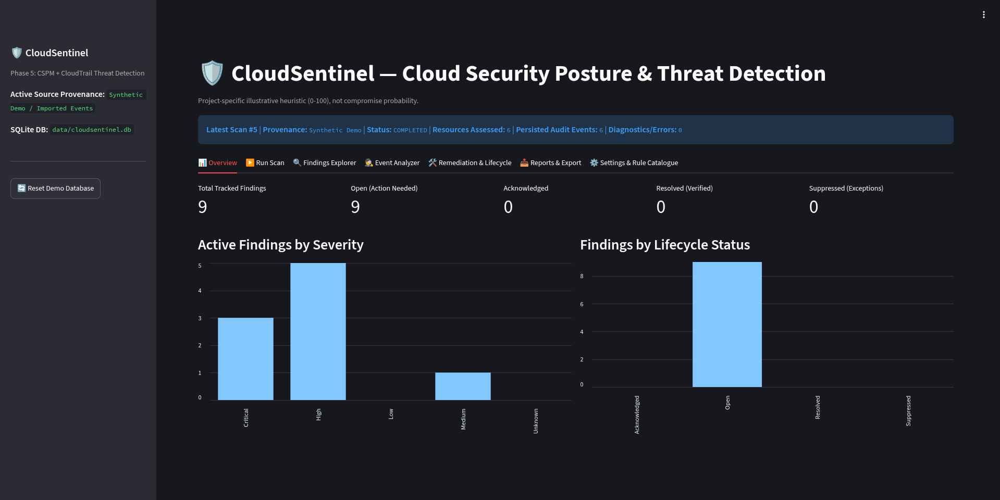
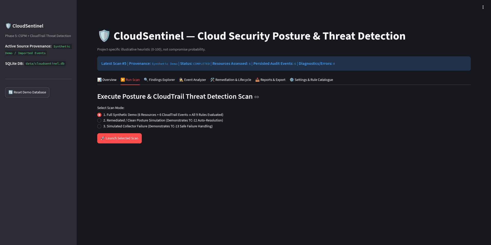
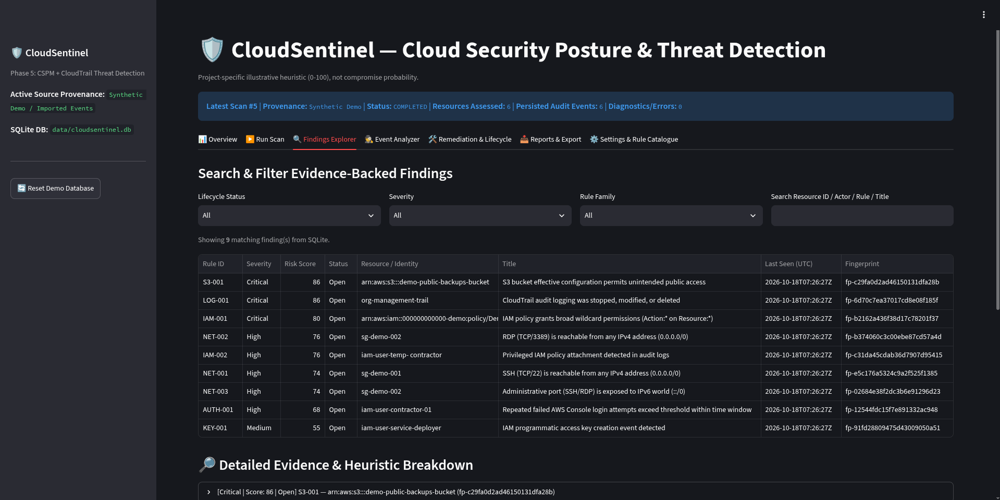
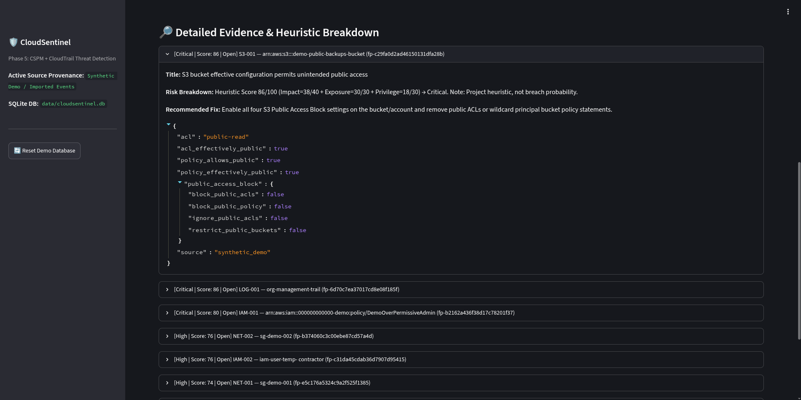
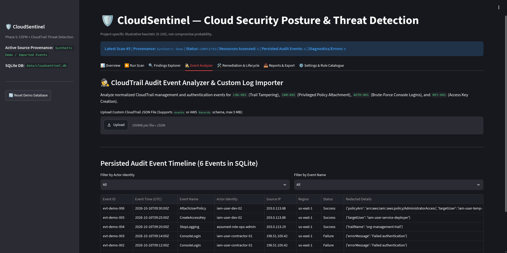
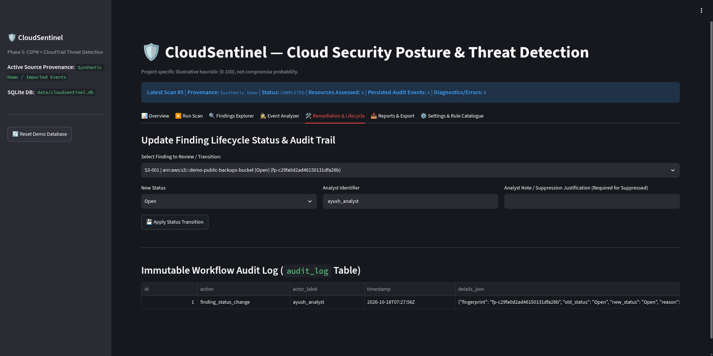
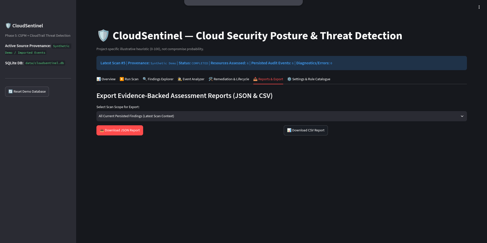
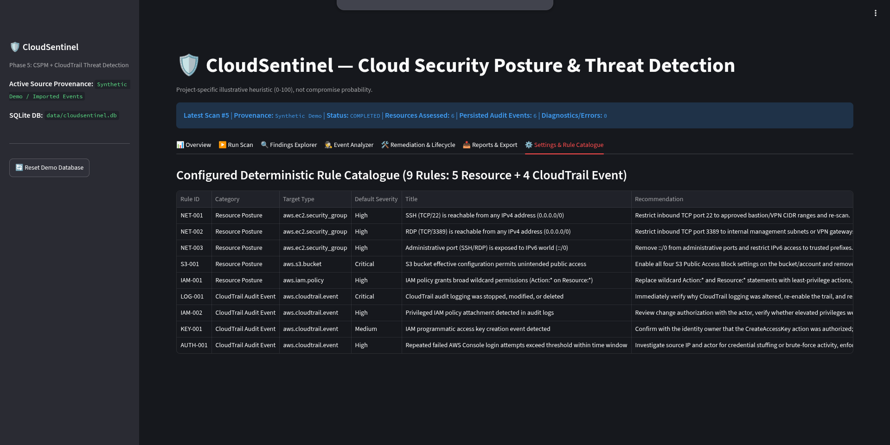

<div align="center">

# 🛡️ CloudSentinel

### Intelligent Cloud Security Posture Assessment & Threat Detection Platform for AWS


**A local-first, modular security platform that assesses AWS misconfigurations, analyzes CloudTrail audit logs, computes explainable risk scores, and tracks finding lifecycles with deterministic deduplication — all through an interactive analyst dashboard.**

[Key Capabilities](#-key-capabilities) • [Screenshots](#-platform-walkthrough) • [Quickstart](#-quickstart) • [Demo Script](#-6-step-live-demonstration-script) • [Docs](#-documentation-index)

</div>

---

## 📌 Overview

CloudSentinel simulates the core workflow of a real CSPM (Cloud Security Posture Management) + SIEM-lite platform: **collect → detect → score → triage → remediate → report**. It runs entirely offline against versioned synthetic AWS fixtures (or live, read-only against a real AWS account via an opt-in Boto3 collector), so it can be demoed and evaluated with zero cloud cost or risk.

## ✨ Key Capabilities

- **🔌 100% Offline-First Synthetic Demo Mode** — Works out-of-the-box without an AWS account using versioned synthetic fixtures (`data/demo/resources.json`, `data/demo/cloudtrail_events.json`).
- **🧩 9 Deterministic Detection Rules** (Resource Posture + CloudTrail Event Analytics):

  | Rule ID | Detects |
  |---|---|
  | `NET-001` | Unrestricted IPv4 SSH (`TCP/22` from `0.0.0.0/0`) |
  | `NET-002` | Unrestricted IPv4 RDP (`TCP/3389` from `0.0.0.0/0`) |
  | `NET-003` | Administrative port exposure over IPv6 (`::/0`) |
  | `S3-001` | Effective S3 bucket public access (`PublicAccessBlock` + ACLs + Bucket Policy) |
  | `IAM-001` | Broad wildcard IAM permissions (`Action:*` on `Resource:*`) |
  | `LOG-001` | CloudTrail audit tampering (`StopLogging`, `DeleteTrail`, `UpdateTrail`) |
  | `IAM-002` | Privileged policy attachment (`AdministratorAccess`, `PowerUserAccess`, `IAMFullAccess`) |
  | `AUTH-001` | Sliding time-window console login brute-force aggregation |
  | `KEY-001` | IAM programmatic access key creation indicator |

- **📊 Explainable Heuristic Risk Model** — `R = Impact(0-40) + Exposure(0-30) + Privilege(0-30)`, a transparent 0–100 prioritization score, clearly labeled as a heuristic rather than a breach-probability prediction.
- **🗄️ Stateful SQLite Deduplication & Safe Auto-Resolution** — Canonical SHA-256 fingerprint (`fp-...`) per issue; repeat scans update `last_seen` without duplicating rows. Vanished issues auto-resolve **only** on `completed` scans, while `failed`/`partial` scans preserve open findings.
- **🔐 Scoped Read-Only AWS Integration** — Optional Boto3 collector with an explicit UI authorization gate and transparent `AccessDenied` diagnostic reporting.
- **📝 Full Audit Trail** — Every lifecycle transition (Open → Acknowledged → Resolved/Suppressed) is logged immutably with analyst identity, timestamp, and justification.

---

## 🖥️ Platform Walkthrough

### 1. Overview Dashboard
At-a-glance posture summary — total findings, lifecycle breakdown, and severity distribution — with full data-source provenance.



### 2. Run Scan
Three selectable scan modes let you demonstrate the full detection lifecycle on demand: full synthetic demo, a remediated/clean posture simulation, and a simulated collector failure.



### 3. Findings Explorer
Search and filter every evidence-backed finding by lifecycle status, severity, and rule family — each with its risk score and deduplication fingerprint.



### 4. Finding Evidence & Heuristic Breakdown
Drill into any finding to see the raw JSON evidence, the exact `Impact + Exposure + Privilege` score breakdown, and the recommended remediation.



### 5. CloudTrail Event Analyzer
Normalized, searchable timeline of CloudTrail management and authentication events, with support for importing custom CloudTrail JSON exports.



### 6. Remediation & Lifecycle
Transition findings through their lifecycle (Open → Acknowledged → Resolved/Suppressed) with mandatory analyst identity and justification, backed by an immutable `audit_log` table.



### 7. Reports & Export
Export provenance-labeled findings as JSON or CSV for a given scan scope — ready to hand off or archive.



### 8. Settings & Rule Catalogue
Full reference view of all 9 configured detection rules — category, target type, default severity, and remediation guidance.



---

## 🚀 Quickstart (Kali Linux / Debian / Ubuntu)

```bash
cd ~/CloudSentinel
source .venv/bin/activate

# 1. Run the 35-test automated verification suite
PYTHONPATH=src .venv/bin/python -m pytest -v

# 2. Run Ruff code quality & security linter
.venv/bin/python -m ruff check src/ tests/ app.py

# 3. Launch the Streamlit Analyst Dashboard
.venv/bin/streamlit run app.py
```

---

## 🎤 6-Step Live Demonstration Script

> For project viva / evaluator walkthroughs.

1. **Start in Offline Demo Mode** — Launch `streamlit run app.py`, click **Reset Demo Database** in the sidebar, and point out the **Data Source Provenance (`Synthetic Demo`)** banner.
2. **Execute Baseline Scan** (`TC-01`–`TC-07`, `TC-11`) — Open **Run Scan**, select **Mode 1 (Full Synthetic Demo)**, click **Launch Selected Scan**. Show the **9 detected findings** (5 Resource + 4 CloudTrail Event), then scan again to prove **SHA-256 deduplication** (Scan ID increments, total findings stay at 9).
3. **Inspect Evidence & Heuristic Breakdown** — Open **Findings Explorer**, filter by `Critical` or `NET`, and expand a finding to show the raw JSON evidence, the `R = I + E + P` breakdown, and remediation advice.
4. **Demonstrate CloudTrail Event Analytics** (`AUTH-001` & `KEY-001`) — Open **Event Analyzer**, show the 6 normalized audit events, and explain why `KEY-001` is a contextual indicator requiring review rather than automatic proof of compromise.
5. **Verify Safe Failure Handling** (`TC-13`) **& Auto-Resolution** (`TC-12`):
   - Run **Mode 3 (Simulated Collector Failure)** — show the red `FAILED SCAN` banner and confirm all 9 Open findings stay `Open`.
   - Run **Mode 2 (Remediated / Clean Posture Simulation)** — show the `COMPLETED` clean scan auto-transitioning findings to `Resolved`.
6. **Audit Trail & Export** (`TC-14`) — In **Remediation & Lifecycle**, transition a finding to `Suppressed` (demonstrating the mandatory justification check and `audit_log` entry), then download the provenance-labeled **JSON** and **CSV** reports in **Reports & Export**.

---

## 🗂️ Project Structure

```
CloudSentinel/
├── app.py                 # Streamlit entrypoint
├── src/                   # Core detection, scoring & provider logic
├── config/                # Rule & scoring configuration
├── data/                  # Synthetic demo fixtures + SQLite DB
├── docs/                  # Architecture, threat model, test plan
├── screenshots/           # Dashboard screenshots (used above)
├── tests/                 # 35-test automated verification suite
└── requirements.txt
```

## 📚 Documentation Index
- [System Architecture, DFD & ER Schema](docs/architecture.md)
- [STRIDE Security & Privacy Threat Model](docs/threat_model.md)
- [Test Plan & TC-01..TC-14 Verification Matrix](docs/test_plan.md)

---

<div align="center">

*Built as a hands-on exploration of CSPM + SIEM-style detection engineering — evaluated via a 35-test automated verification suite and a STRIDE threat model.*

</div>
