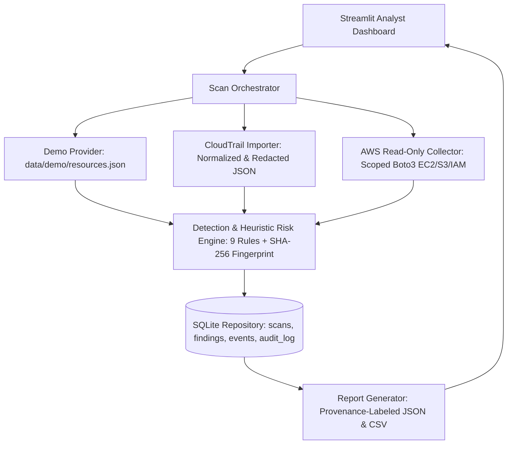

# CloudSentinel — System Architecture & Design Specification

## 1. Logical Architecture (Local-First CSPM & Threat Detection)

## 2. Data Flow Diagram (DFD Level 1)
1. **Collection & Normalization:** Providers (`demo_provider.py`, `cloudtrail_importer.py`, `aws_provider.py`) ingest raw JSON or read-only AWS API responses, validate required schema keys, redact sensitive keys (`secretAccessKey`, `password`, `sessionToken`), and emit a `CollectionBundle` with explicit `diagnostics`.
2. **Rule Evaluation & Heuristic Scoring:** `scanner.py` evaluates 5 Resource Rules (`NET-001`, `NET-002`, `NET-003`, `S3-001`, `IAM-001`) and 4 CloudTrail Event Rules (`LOG-001`, `IAM-002`, `KEY-001`, `AUTH-001`). Missing required fields generate diagnostics rather than false-safe results.
3. **Deduplication & Lifecycle Persistence:** `deduplication.py` computes a canonical SHA-256 fingerprint (`fp-<24_hex>`). `repository.py` performs atomic SQLite transactions: updating `last_seen` on recurring issues, auto-resolving vanished issues **only** on `completed` scans, and preserving `Open` status on `failed` or `partial` scans.

## 3. Entity-Relationship (ER) Database Schema
- **`scans` Table:** `id (PK)`, `provider`, `provenance_label`, `region`, `started_at`, `finished_at`, `status (completed|partial|failed)`, `resources_scanned`, `errors_count`, `diagnostics_json`
- **`findings` Table:** `id (PK)`, `scan_id (FK -> scans.id)`, `rule_id`, `resource_id`, `resource_type`, `region`, `severity`, `risk_score`, `title`, `evidence_json`, `score_breakdown_json`, `recommendation`, `status`, `fingerprint (UNIQUE)`, `first_seen`, `last_seen`, `analyst_note`, `suppressed_by`, `suppressed_reason`
- **`events` Table:** `id (PK)`, `source_event_id (UNIQUE)`, `event_time`, `event_name`, `actor`, `source_ip`, `region`, `status`, `raw_json`
- **`audit_log` Table:** `id (PK)`, `action`, `actor_label`, `timestamp`, `details_json`
